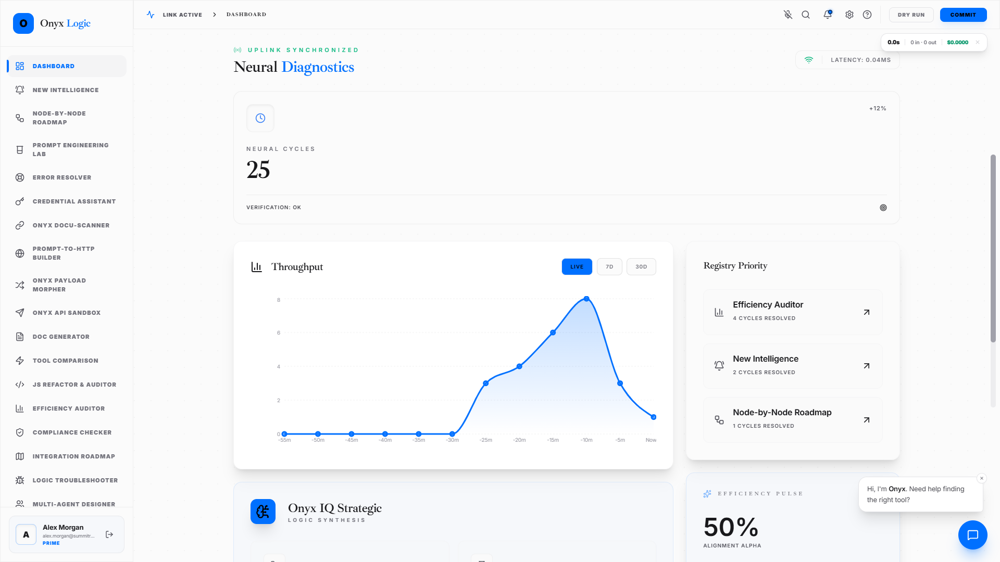
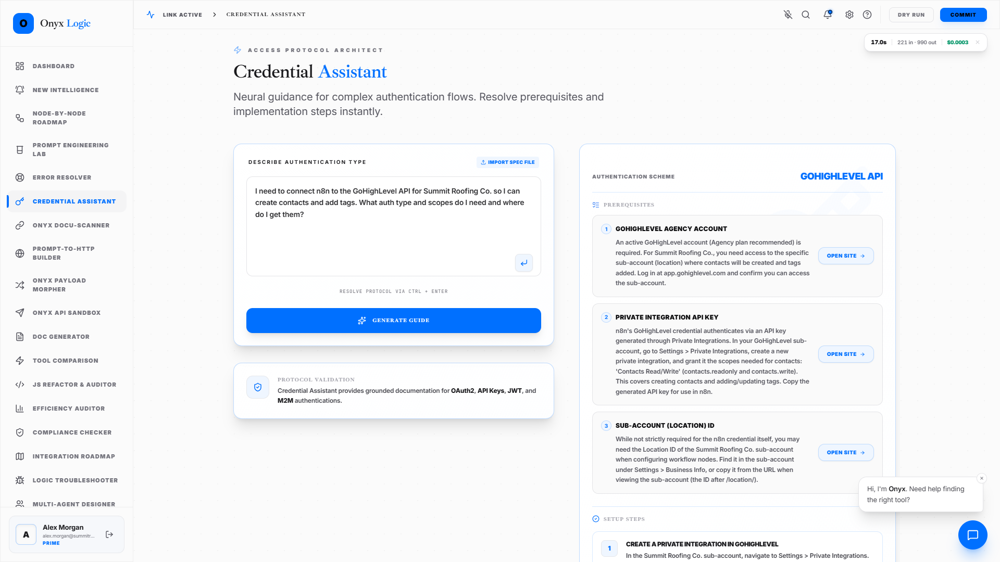
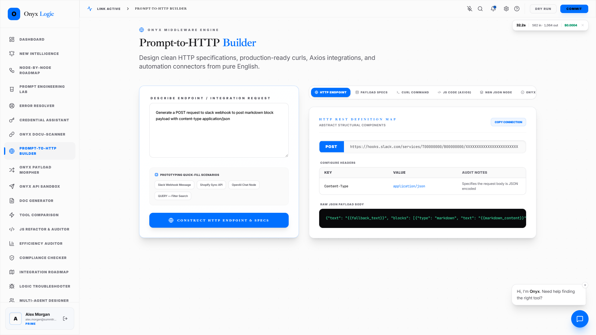
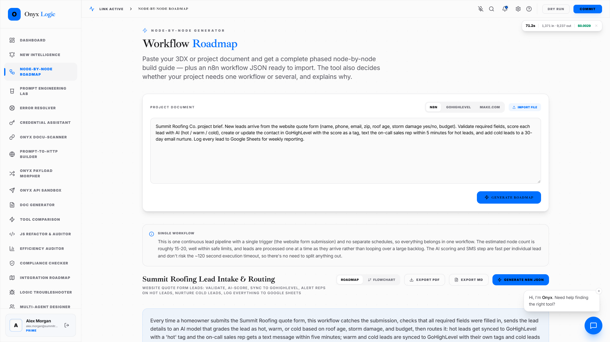
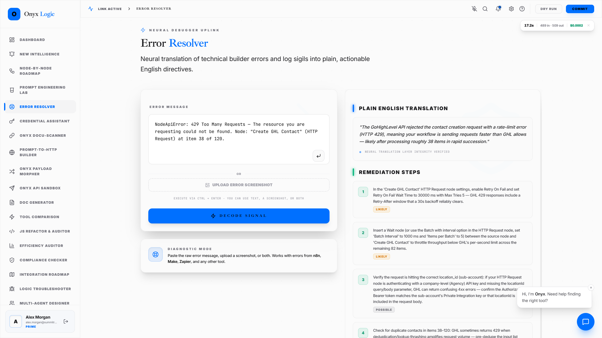

# Onyx Logic

**An AI workbench for automation builders.** Onyx helps people who build workflows in n8n, Make.com and GoHighLevel get answers they can trust. It finds the right credentials, builds working HTTP requests, reads API documentation and plans whole workflows, all from plain-English requests.

The difference from a normal AI chat is that **Onyx checks its answers against the real documentation**. It does not answer from memory. It searches the platform's official site, reads the pages, and shows you which page each answer came from.

▶ **[Watch the 21-second promo video](docs/onyx-promo.mp4)**



---

## The problem

Automation builders lose hours on the same three jobs:

- working out how a platform's login works;
- turning API documentation into a request that runs;
- planning which nodes a workflow needs.

General AI tools answer these questions confidently and are often wrong. Their training data is out of date, and they invent field names and endpoints. Onyx was built to remove that guesswork.

## What it does

| Tool | What you give it | What you get |
|---|---|---|
| **Credential Assistant** | "Connect n8n to GoHighLevel to create contacts" | A step-by-step login setup guide: account, scopes, where to copy each value. Every step comes from the platform's own docs. |
| **Prompt-to-HTTP Builder** | "Send an SMS with Twilio" | A ready request for n8n, Make.com or cURL: method, URL, headers, body format and required fields, all checked against the docs. |
| **Docu-Scanner** | A docs link and a question | An answer taken only from that website, with the exact pages it used. |
| **Node-by-Node Roadmap** | A project brief | A phased build plan and an importable n8n workflow. Node types are checked against the real list of 561 n8n node types. |
| **Make.com module check** | A generated Make.com blueprint | Each module checked against a verified list of real Make.com modules. |
| **SQL Generator** | "Show me last month's new customers" | A SQL script with a 🟢 / 🟡 / 🔴 safety label from fixed rules, a preview-first script for risky changes, and a check against your table layout. |
| **Error Resolver, Tool Comparison, Compliance Checker, Doc Generator, Prompt Lab and more** | | 20+ tools in total, in one workspace |

| | |
|---|---|
|  |  |
|  |  |

## How it works

```
 Your question
      │
      ▼
 Plan ──► Search the official site ──► Read the pages ──► Collect facts tied to their source
      ▲                                                          │
      └──────── more to find? search again ◄─────────────────────┘
                                                                 │
                                                                 ▼
                                      Answer written ONLY from those facts, with sources listed
```

- **Research engine.** The AI plans what to look up, searches, and reads pages in full. It records each fact together with the page it came from, and stops as soon as every part of the question is answered.
- **It stays on official sites.** It searches inside the platform's own domain. It can also read docs that only render in a browser, through their OpenAPI / Postman data files.
- **Saved answers.** Repeat questions are answered instantly for 7 days. A code change automatically retires old answers, so they are never stale (`services/answerCache.ts`).
- **Live progress.** The screen shows each step as it happens ("Searching docs.n8n.io…", "Reading…"), so a 30-second answer never feels frozen (`services/progress.ts`, `components/RunProgress.tsx`).
- **Fixed-rule checks, not AI opinions,** wherever correctness matters: SQL safety labels, SQL layout checks, n8n node validation and Make.com module validation (`utils/`).
- **Cost control.** Model choice is per task ("Advanced tasks" / "Simple tasks"), and every run shows its live cost. A typical researched answer costs about 1–2 cents and takes about 20–40 seconds.

## Built with

React 19 · TypeScript · Vite · Tailwind · Express · OpenRouter (multi-model: Gemini, GLM) · Tavily web search · Firebase Auth + Firestore

## What's in this repository

This is a **showcase edition** of the app:

- **Included:** the full front end (all tool screens, layout, components) and the client-side services (saved answers, live progress, the tool catalogue). It also includes the fixed-rule validators in `utils/`, the Firestore security rules and the verified n8n and Make.com reference data.
- **Not included:** the research engine, the AI instructions and the server. These are the core of the product and stay private, so this edition does not run on its own.

**A live demo or a code walkthrough of the private engine is available on request.**

---

© 2026 Tinashe Shoko. All rights reserved. See [LICENSE](LICENSE).
